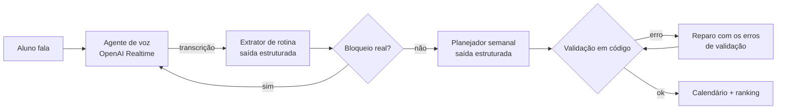

# Sofia & Edu: o planner de voz que entende que o aluno tem uma vida

> Assistente de voz com IA que conversa com o aluno de EAD, entende a rotina real dele (trabalho, deslocamento, família, sono) e monta uma semana de estudos que cabe nessa vida, publicando tudo no calendário acadêmico.

**Hackathon Vitru Educação 2026 · Grupo 5** · protótipo funcional · [pitch completo (PDF)](./Pitch_Hack_Grupo_5.pdf)


---

## O problema

> *"Eu quero estudar, mas não consigo encaixar a faculdade na minha rotina."*

A aluna que trabalha o dia inteiro, chega cansada e ainda tem compromissos pessoais não perdeu o interesse pela faculdade. Ela só não consegue encaixar o estudo na vida que já tem. Segundo o Censo EaD.Br, compilado pela ABED, a falta de tempo é apontada como a principal causa de evasão na EAD no Brasil.

| Dado | Valor | Fonte |
|---|---|---|
| Alunos matriculados na Vitru | 1,031 milhão (2T25) | Release de Resultados Vitru 1T26 |
| Base em cursos semipresenciais ou EAD | mais de 97,6% | Release de Resultados Vitru 1T26 |
| Evasão no recorte analisado (1º semestre de 2026) | 23,7% de 90.937 alunos, ou 21.523 alunos | base interna do projeto |
| Receita em risco nesse recorte | cerca de R$ 23 milhões (21.523 × R$ 1.080 em 6 meses) | premissa de ticket da equipe |

**A cadeia que a Sofia quer quebrar:** rotina desorganizada, depois atraso e acúmulo de atividades, depois queda de engajamento e, por fim, evasão. A Sofia entra logo depois da matrícula, **antes** da evasão começar.

---

## A solução

A **Sofia** (Uniasselvi) e o **Edu** (UniCesumar) conversam por voz com o aluno. Cada um tem voz e identidade visual próprias.

1. **Conversa por voz:** a assistente pergunta só o que **não** está na grade acadêmica, ou seja, disponibilidade, trabalho, deslocamentos e preferências. É uma pergunta por vez, sem cara de formulário.
2. **Extração da rotina:** a conversa vira dados estruturados. Se algo ambíguo puder mudar o planejamento, ela faz uma pergunta curta de esclarecimento.
3. **Planejamento:** a IA monta uma semana de segunda a domingo. Ela preserva as aulas, o sono e o trabalho, e distribui as horas de estudo autônomo.
4. **Calendário e gamificação:** os compromissos vão para o calendário acadêmico. Concluir tarefas dá pontos e posição no ranking.
5. **Analytics:** um painel mostra para a instituição como esses dados podem virar indicadores de retenção.


---

## Como a IA funciona

O sistema não é "um prompt grande". São **três etapas de IA encadeadas**, cada uma com um papel, um contrato de saída e uma verificação em código.



### Técnicas aplicadas

| Técnica | Como foi aplicada | Onde está |
|---|---|---|
| **Encadeamento de prompts** | Voz, extração e planejamento são chamadas separadas, cada uma com uma única função. Isso facilita depurar e validar entre as etapas | `server/prompts/` |
| **Engenharia de contexto** | A grade acadêmica é anexada ao contexto da assistente de voz, então ela **não pergunta o que já sabe**. O extrator só aceita como evidência as falas do aluno (`user_facts`); as falas da IA servem apenas para interpretar um "sim" | `voice-agent.ts`, `routine-extractor.ts` |
| **Saída estruturada com schema** | O extrator e o planejador devolvem JSON validado por schemas Zod (`zodTextFormat`). Horário desconhecido é `null` de verdade, nunca "N/A" | `shared/schemas/` |
| **Ciclo de verificar e corrigir** | A semana gerada passa por uma validação em código (sobreposição, aulas preservadas, horários válidos). Se falhar, o modelo recebe **os próprios erros** e corrige numa segunda chamada | `server/index.ts` (rota `/api/schedule`) |
| **Uso de ferramentas no Realtime** | A assistente chama `wait_for_user` quando só ouve ruído ou silêncio e `complete_onboarding` quando a rotina está completa | `server/realtime-tools.ts` |
| **Regras contra invenção** | Nenhuma etapa inventa horário, prazo ou tarefa. O calendário não cria atividade quando não há uma tarefa importada | prompts e `calendario.js` |
| **Restrições de comportamento** | No máximo duas frases e uma pergunta por turno, sem anunciar etapas e sem frases burocráticas. Sono e despertar são tratados como dados independentes | `voice-agent.ts` |

### Configuração dos modelos

| Etapa | Modelo | Parâmetros | Por quê |
|---|---|---|---|
| Voz | `gpt-realtime-2.1` | raciocínio `low`, até 2.048 tokens de saída, redução de ruído `near_field`, VAD `medium` | a conversa precisa de resposta rápida e natural |
| Extração e planejamento | `gpt-5.6-luna` | raciocínio `high` e saída com schema | são decisões com várias restrições ao mesmo tempo, então vale gastar mais raciocínio |

**Por que não usamos `temperature`:** os dois modelos são de raciocínio, e neles a variação é controlada pelo **nível de esforço de raciocínio** (`reasoning.effort`), não pela temperatura. A consistência da saída vem do schema, da validação em código e do ciclo de reparo, e não de "travar" o modelo.

### Segurança

- A chave da OpenAI fica **só no backend**. O navegador recebe uma credencial temporária, válida só para aquela sessão de voz.
- O texto do aluno não vai para os logs de diagnóstico por padrão (`VOICE_DIAGNOSTICS=false`).

---

## Minha contribuição

Sou **Maria Eduarda Leonardo De Souza** e, neste projeto, fiquei com quatro frentes:

**Interface da Sofia e do Edu** (`Front/SOFIA-EDU-CHAT`)
- Chat conversacional em HTML, CSS e JavaScript, com a troca de identidade visual entre Sofia (Uniasselvi) e Edu (UniCesumar).
- Interação por respostas rápidas e uma experiência pensada para quem não quer preencher formulário.
- Repositório da minha versão do front: [Front_Planner_De_Voz_Hack_Vitru](https://github.com/MariaEduardaSouza001/Front_Planner_De_Voz_Hack_Vitru).

**Dashboard de Analytics** (`Analytics/vitru-analytics-dashboard`)
- Painel em **React 19, TypeScript, Tailwind 4 e Recharts**, com tema claro e escuro.
- Indicadores do "resgate de calouros": onboarding com a assistente, alunos sem entrega na 1ª disciplina, receita prospectada e tempo de interação.
- Comparação entre o desempenho atual e o projetado em cada avaliação, e um funil de engajamento, separados por instituição.

**Apoio aos testes da IA**
- Ajudei a testar as conversas com a assistente de voz e o plano semanal gerado, simulando rotinas de alunos e apontando respostas fora do esperado para a equipe ajustar.

**Pitch e defesa para a banca** ([PDF](./Pitch_Hack_Grupo_5.pdf))
- Idealizei o pitch: a narrativa da apresentação, de tempo e rotina até entrega, engajamento, retenção e receita.
- Fiz a pesquisa do problema e dos dados de evasão na EAD.
- Fiz as pesquisas e análises que deram origem ao **ROI, ao CAPEX e ao OPEX** do projeto, incluindo o dimensionamento da receita em risco e o retorno esperado do piloto.

**O que aprendi:** desenhar a experiência de uma IA conversacional, em que o tom, o número de perguntas e o que *não* perguntar fazem tanta diferença quanto o modelo. Também aprendi a traduzir um produto de IA em indicadores de negócio que uma banca consegue avaliar.

---

## Equipe

| Integrante | |
|---|---|
| Gabriel Augusto | [@Gabriel-ASM](https://github.com/Gabriel-ASM) |
| Henrique Soares Serra | |
| Eduardo Barbosa | |
| Maria Eduarda Leonardo De Souza | [@MariaEduardaSouza001](https://github.com/MariaEduardaSouza001) |

Padrinho: Alan Roberto de Oliveira · Repositório original da equipe: [Gabriel-ASM/hackathon-vitru-grupo-cinco](https://github.com/Gabriel-ASM/hackathon-vitru-grupo-cinco)

---

## Arquitetura

```
Front/SOFIA-EDU-CHAT       interface principal e menu lateral
        │
        ├── /api/realtime/session   credencial temporária de voz
        ├── /api/routine/extract    rotina estruturada
        └── /api/schedule           semana validada
                    │
                    ▼
              shared/               schemas, regras e contrato do calendário
                    │
        ┌───────────┴───────────┐
        ▼                       ▼
  /calendario/             /analytics/
  visão acadêmica          dashboard indicativo
```

| Camada | Local | Responsabilidade |
|---|---|---|
| Interface | `Front/SOFIA-EDU-CHAT` | Chat, identidade visual, voz e atalhos |
| Sessão de voz | `client/src/voice` | WebRTC, eventos Realtime e diagnósticos |
| Backend | `server/` | Sessões, extração, planejamento e validação |
| Domínio compartilhado | `shared/` | Tipos, schemas, regras de rotina e importação acadêmica |
| Calendário | `Calendário/sistema-de-recompensa-/calendario` | Grade semanal, pontos e ranking |
| Analytics | `Analytics/vitru-analytics-dashboard` | Dashboard demonstrativo acessível pelo menu |

---

## Como executar

Use Node.js 20 LTS ou 22 LTS. O Node 21 não está na faixa suportada pelo Vite deste projeto.

```bash
npm install
npm --prefix Analytics/vitru-analytics-dashboard install
cp .env.example .env        # PowerShell: Copy-Item .env.example .env
npm run dev
```

Preencha `OPENAI_API_KEY` no `.env`. Sem a chave, a interface e o calendário continuam navegáveis, mas a conversa por voz e a geração de uma nova semana não funcionam.

| Endereço | O que abre |
|---|---|
| http://localhost:5173/ | chat principal |
| http://localhost:5173/?debug=true | painel de diagnóstico |
| http://localhost:5173/calendario/ | calendário acadêmico |
| http://localhost:5173/analytics/ | analytics |

Variáveis principais do `.env.example`: `REALTIME_MODEL`, `PLANNER_MODEL`, `PLANNER_REASONING_EFFORT`, `REALTIME_VOICE`, `REALTIME_NOISE_REDUCTION`, `REALTIME_VAD_EAGERNESS`, `REALTIME_REASONING_EFFORT`, `REALTIME_MAX_OUTPUT_TOKENS` e `VOICE_DIAGNOSTICS`.

### Testes e validação

```bash
npm test         # 6 suítes: validação da semana, calendário, extração, normalização, perfil de voz e diagnósticos
npm run check    # checagem de tipos do TypeScript
npm run build
```

---

## Limites desta versão (e próximos passos)

- O `Aulas.json` é uma grade local de demonstração. O próximo passo é integrar com o SIS e o AVA.
- O calendário usa `localStorage` para demonstrar o contrato de importação (`sofiaAcademicCalendar.v2`) e ainda não tem persistência de produção.
- O Analytics usa dados de demonstração e ainda não consome a agenda real.
- O ranking é ilustrativo. Em produção, ele dependeria de dados reais de conclusão.
- Os valores de custo e retorno do pitch são preliminares e precisam ser validados com os times técnico e financeiro.
